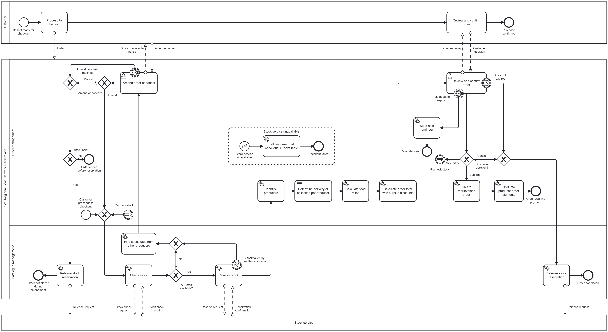

# FN1 Process order (`process_order`)

**Task:** 5.2 ([#146](https://github.com/ssrhaso/UFCFTR-30-3-DESP/issues/146)), part of 5.1 ([#144](https://github.com/ssrhaso/UFCFTR-30-3-DESP/issues/144))
**Model:** Ishaq Modassir Mushtaq and Shamy ([#165](https://github.com/ssrhaso/UFCFTR-30-3-DESP/pull/165)). **PNG export, forms and this document:** Hasaan Ahmad
**Status:** for review. The display variables of section 6 are proposals for the job workers (6.1).

## 1. Files

| File | Content |
|---|---|
| `process-order.bpmn` | The operational BPMN model and the executable Camunda 8.6 process. Process ID `process_order` |
| `process-order.png` | Export of the model, rendered with bpmn-js (the renderer of the Camunda Modeler) |
| `form-review-order.form` | Camunda Form of the user task "Review and confirm order" |
| `form-amend-order.form` | Camunda Form of the user task "Amend order or cancel" |
| `process-order.md` | This document |

The scope is section 4.2 of [functionalities.md](../../requirements/scope/functionalities.md). The names follow its section 4.4.

## 2. Contributions

| Date | Member | Work |
|---|---|---|
| 10 Nov 2026 | Ishaq Modassir Mushtaq | First draft of the model: the three pools, the two lanes, the stock check and the reservation, the amend and review user tasks, the producer and arrangement tasks, and the order creation and split |
| 12 Nov 2026 | Shamy | The exception paths and the timers: the substitutes, the stock taken during the reservation, the amend time limit, the stock hold expiry with its reminder, the "Add items" loop, the stock service failure, the food miles and the surplus discounts. The lane and pool names of the strategic model |
| 13 Nov 2026 | Royden Dias | Review and approval |
| 14 Nov 2026 | Hasaan Ahmad | The PNG export. The two forms. This document |

## 3. How to read the model

| Part | Content |
|---|---|
| Customer pool (top) | The customer's own steps: proceed to checkout, then review and confirm the order. Not executable |
| Network pool | `process_order`, the executable process. The lanes are the functions of the strategic model: F02 Order management and F01 Catalogue management |
| Stock service pool (bottom) | A collapsed pool for the stock check, the reservation and the release |
| Event sub-process | "Stock service unavailable" stops the checkout and tells the customer |

**Who does each activity** (the brief asks the demonstration to show this):

| Actor | Activities |
|---|---|
| The customer | The two user tasks, in Camunda Tasklist, with the two forms |
| The process engine | The gateways, the three timers, the link events "Recheck stock" and the error events |
| The job workers (6.1) | The 13 service and business rule tasks (section 8) |
| External service | The stock service checks, reserves and releases the stock |

## 4. Elements for each point of the scope

| Point of functionalities.md 4.2 | Element |
|---|---|
| The customer amends the order when an item is unavailable (O01, O02) | User task "Amend order or cancel", form `form-amend-order`, gateway "Amend or cancel?" |
| The customer reviews the order summary and confirms the purchase (M04) | User task "Review and confirm order", form `form-review-order`, gateway "Customer decision?" |
| The system checks the stock of each item | Service task "Check stock" (`check-stock`), gateway "All items available?" |
| The system identifies the producers, creates the order and splits it | "Identify producers" (`identify-producers`), "Create marketplace order" (`create-order`), "Split into producer order elements" (`split-order`) |
| Is each item available in the requested quantity? | Gateway "All items available?" with `=allAvailable = true` |
| Delivery or collection for each producer, at least 48 hours ahead | Business rule task "Determine delivery or collection per producer" (`determine-arrangements`) |
| The stock service checks and reserves the stock | "Check stock", "Reserve stock" (`reserve-stock`), collapsed pool "Stock service" |
| The postcode distance service gives the food miles (optional) | "Calculate food miles" (`calculate-food-miles`). A missing postcode does not stop the order |
| The basket lines, the stock, the producers and the arrangements become the order | Section 6 |
| An item is unavailable: the customer amends the order, then the check runs again | "Find substitutes from other producers", "Amend order or cancel", then back to "Check stock" |
| The customer does not confirm within the time limit | Interrupting timer "Stock hold expired" on the review task, then "Release stock reservation" |
| The stock service does not respond | Event sub-process "Stock service unavailable" (`STOCK_SERVICE_UNAVAILABLE`) |

## 5. Exception and alternative paths

| Situation | Path | Result |
|---|---|---|
| An item is unavailable at the check (U3) | "All items available?" (No), "Find substitutes from other producers", "Amend order or cancel" | Amend: "Check stock" again. Cancel: see below |
| Another customer takes the stock during the reservation | Error `INSUFFICIENT_STOCK` on "Reserve stock", then the same amend path | As above |
| The customer cancels at the amend task, or 30 minutes pass | "Stock held?" decides | Stock held: "Release stock reservation", then "Order not placed during amendment". No stock held: "Order ended before reservation" |
| The stock hold is about to expire | Non-interrupting timer "Hold about to expire", then "Send hold reminder" | The review task stays open |
| The stock hold expires | Interrupting timer "Stock hold expired" | "Release stock reservation", then "Order not placed" |
| The customer adds items at the review | "Customer decision?" (Add items), link event "Recheck stock" | Back to "Check stock" |
| The customer cancels at the review | "Customer decision?" (default) | "Release stock reservation", then "Order not placed" |
| The stock service is unavailable | Error `STOCK_SERVICE_UNAVAILABLE` starts the event sub-process | "Tell customer that checkout is unavailable", then "Checkout failed" |

## 6. Process variables

| Variable | Set by | Read by | Status |
|---|---|---|---|
| `allAvailable` | `check-stock` | "All items available?" | In the model |
| `reservationId` | `reserve-stock` | "Stock held?" | In the model |
| `reservationExpiresAt`, `reservationReminderAt` | `reserve-stock` | The two timers on the review task. FN2 also reads `reservationExpiresAt` | In the model |
| `addOnSuggestions` | `identify-producers` | The order summary | In the model |
| `amendDecision` | Form `form-amend-order`: `amend` or `cancel` | "Amend or cancel?" | In the model |
| `reviewDecision` | Form `form-review-order`: `confirm`, `addItems` or `cancel` | "Customer decision?" | In the model |
| `orderLines` | `calculate-order-total`: list of `productName`, `producerName`, `quantity`, `lineTotal` | Form `form-review-order` | Proposal for 6.1 |
| `orderTotal` | `calculate-order-total` | Form `form-review-order`, FN2 | Proposal for 6.1. FN2 uses this name |
| `foodMiles` | `calculate-food-miles`. Absent when there is no postcode | Form `form-review-order` (hidden when absent) | Proposal for 6.1 |
| `unavailableItems` | `check-stock` or `reserve-stock`: list of `productName`, `producerName`, `requestedQuantity`, `availableQuantity` | Form `form-amend-order` | Proposal for 6.1 |
| `substitutes` | `find-substitutes`: list of `productId`, `productName`, `producerName`, `unitPrice` | Form `form-amend-order` (hidden when empty) | Proposal for 6.1 |
| `acceptedSubstitutes` | Form `form-amend-order`: list of `productId` | `check-stock` on the next check | Proposal for 6.1 |
| `orderId`, `producerOrders` | `create-order`, `split-order` | FN2 | Proposal for 6.1. FN2 uses these names |

## 7. Errors and timers

| Kind | Name | Detail |
|---|---|---|
| Error | `INSUFFICIENT_STOCK` | Thrown by `reserve-stock` when another customer took the stock |
| Error | `STOCK_SERVICE_UNAVAILABLE` | Thrown by a stock worker after its job retries. Starts the event sub-process |
| Timer | "Amend time limit reached" | `PT30M`, interrupting |
| Timer | "Hold about to expire" | `=reservationReminderAt`, non-interrupting |
| Timer | "Stock hold expired" | `=reservationExpiresAt`, interrupting |

## 8. Job types for the workers (6.1)

| Job type | Task | Rule |
|---|---|---|
| `check-stock` | Check stock | Compare each basket line with the stock. Set `allAvailable` and `unavailableItems` |
| `reserve-stock` | Reserve stock | Reserve the items. Set `reservationId`, `reservationExpiresAt` and `reservationReminderAt`. Throw `INSUFFICIENT_STOCK` if the stock has gone |
| `find-substitutes` | Find substitutes from other producers | Set `substitutes` |
| `release-stock` | Release stock reservation (two tasks) | Release `reservationId`. FN2 uses the same job type |
| `identify-producers` | Identify producers | Group the lines by producer. Set `addOnSuggestions` |
| `determine-arrangements` | Determine delivery or collection per producer | Set a date at least 48 hours after the order for each producer (NFR07) |
| `calculate-food-miles` | Calculate food miles | Ask the postcode distance service. Set `foodMiles`, or nothing |
| `calculate-order-total` | Calculate order total with surplus discounts | Apply the surplus discounts (R15). Set `orderLines` and `orderTotal` |
| `notify-customer` | Send hold reminder, Tell customer that checkout is unavailable | Send the message to the customer. FN2 uses the same job type |
| `create-order` | Create marketplace order | Set `orderId` |
| `split-order` | Split into producer order elements | Set `producerOrders` with `producerOrderId`, `producerId` and `subtotal` |

## 9. Hand-over to FN2

FN1 ends at "Order awaiting payment". FN2 (`process_payment`) starts with `orderId`, `customerId`, `orderTotal`, `producerOrders` and `reservationExpiresAt`. The stock reservation of FN1 stays active during the payment (S1). The start mechanism is open (S2): a call activity of the parent process, or a message.

## 10. Traceability

These cells are for rows U2 to U6 of [traceability.md](../../requirements/traceability.md). PR #166 changes the next rows of that table. Copy them into the table after #166 merges, to avoid a merge conflict.

| Row | Operational BPMN (5.1) | Camunda (6.1) |
|---|---|---|
| U2 | "Check stock", "All items available?", "Reserve stock" with "Stock taken by another customer" | Job types `check-stock` and `reserve-stock`. Condition `=allAvailable = true`. Error `INSUFFICIENT_STOCK` |
| U3 | "Find substitutes from other producers", user task "Amend order or cancel", "Amend or cancel?", "Stock held?" | Form `form-amend-order` (`amendDecision`, `acceptedSubstitutes`). Timer `PT30M`. Job types `find-substitutes`, `release-stock` |
| U4 | "Identify producers", "Determine delivery or collection per producer", "Calculate food miles", "Calculate order total with surplus discounts" | Job types `identify-producers`, `determine-arrangements`, `calculate-food-miles`, `calculate-order-total` |
| U5 | User task "Review and confirm order", "Customer decision?", the two timers, "Send hold reminder" | Form `form-review-order` (`reviewDecision`). Timers `=reservationReminderAt` and `=reservationExpiresAt`. Job type `notify-customer` |
| U6 | "Create marketplace order", "Split into producer order elements", end event "Order awaiting payment" | Job types `create-order` and `split-order`. Outputs `orderId` and `producerOrders` for FN2 |

| Element | i* element ([model-content.md](../istar/model-content.md)) | Strategic BPMN | Stories |
|---|---|---|---|
| Check stock, All items available? | MP06 Check stock, SD12 Accurate stock levels | P04 Process order (F02), after M04 Order | B01 |
| Find substitutes, Amend order or cancel | MP07 Ask customer to amend order, CU08 Amend unavailable items, SD08 | None (happy path, D1 of the strategic README) | B02 |
| Identify producers, Determine delivery or collection | MP08 Identify producers and arrangements, SD13, SD15 | P04 | B03, B04 |
| Calculate food miles | NW12 Sustainability, through P09 | P09 Report food miles (F05) | B09 |
| Review and confirm order | MP09 Get customer confirmation, CU07, SD07 | M04 Order from the Customer pool | B05 |
| Reserve stock, the two timers, Release stock reservation | MP13 Reserve stock for a time limit (chosen), MP12 | P04 | B07, B08 |
| Create marketplace order, Split into producer order elements | MP10 Create and split marketplace order, SD01 | P04, then P05 Process payment | B06 |

## 11. Checks

| Check | Result |
|---|---|
| `bpmnlint:recommended` and `camunda-compat/camunda-cloud-8-6`, with the Zeebe schema loaded, as in the Web Modeler | 0 errors, 0 warnings |
| Import with bpmn-js 17.11 | No import warnings |
| Both forms with form-js 1.10 (schema version 16, Camunda 8.6) | Both render with no errors, with and without the optional data |
| Deployment to the Camunda 8 cluster | To do in 6.1 |

## 12. Open point

The "Stock service" pool is not in the strategic model or in `actors.md` (E01 to E06). FN2 also uses a stock service, but has no pool for it. The group can add the stock service as an external service, or show the stock work in the F01 Catalogue management lane. The [comment on #165](https://github.com/ssrhaso/UFCFTR-30-3-DESP/pull/165#issuecomment-6878576434) asks the group to agree this at the stand-up.
