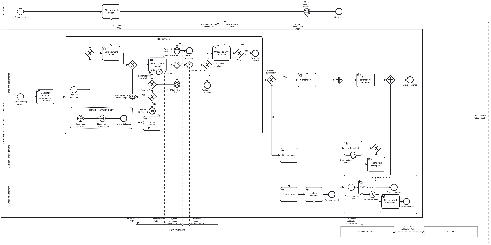

# FN2 Process payment (`process_payment`)

**Task:** 5.4 ([#147](https://github.com/ssrhaso/UFCFTR-30-3-DESP/issues/147)), part of 5.1 ([#144](https://github.com/ssrhaso/UFCFTR-30-3-DESP/issues/144))
**Model:** Royden Dias ([#166](https://github.com/ssrhaso/UFCFTR-30-3-DESP/pull/166)). **First draft, refinement proposals, forms, layout and this document:** Hasaan Ahmad
**Status:** for review. The values of S1 to S4 (section 9) are proposals until the group agrees them.



## 1. Files

| File | Content |
|---|---|
| `process-payment.bpmn` | The operational BPMN model and the executable Camunda 8.6 process. Process ID `process_payment` |
| `process-payment.png` | Export of the model, rendered with bpmn-js (the renderer of the Camunda Modeler) |
| `payment-details.form` | Camunda Form of the user task "Give payment details" |
| `retry-or-cancel.form` | Camunda Form of the user task "Choose to retry or cancel" |
| `process-payment.md` | This document |

The scope is section 4.3 of [functionalities.md](../../requirements/scope/functionalities.md). The names follow its section 4.4.

## 2. Contributions

| Date | Member | Work |
|---|---|---|
| 9 Nov 2026 | Hasaan Ahmad | First draft of the model and of the two forms. Six proposed refinements, in a comment on [#147](https://github.com/ssrhaso/UFCFTR-30-3-DESP/issues/147#issuecomment-6739382905) |
| 13 Nov 2026 | Royden Dias | The model in this folder. It applies refinements 1, 2, 4, 5 and 6 that the tutor agreed: the asynchronous payment, the lanes of the strategic model, the refund by compensation, the failures after the payment and the Customer pool |
| 14 Nov 2026 | Hasaan Ahmad | The payment pool named as in the strategic model. The reason for the Producer pool. A layout tidy (labels and three message-flow routes only). The two forms. This document. The FN2 rows of the traceability table |

## 3. How to read the model

| Part | Content |
|---|---|
| Customer pool (top) | The customer's own steps: the order placed in FN1, the payment details and the order confirmation. Not executable |
| Network pool | `process_payment`, the executable process. The lanes are the functions of the strategic model: F03 Finance and settlements, F01 Catalogue management and F02 Order management |
| Sub-process "Take payment" | The payment details, the payment request, the wait for the answer, the decline loop and the unavailable loop. Its event sub-process handles the expiry of the stock reservation |
| After "Take payment" | The gateway "Payment successful?". Yes: confirm the order, then update the stock, notify each producer and record the payment, in parallel. No: release the stock, cancel the order and tell the customer |
| Collapsed pools (bottom) | Payment service (E01, sandbox or mock), Notification service (E03) and Producer (A04) |

**Who does each activity** (the brief asks the demonstration to show this):

| Actor | Activities |
|---|---|
| The customer | The two user tasks, in Camunda Tasklist, with the two forms |
| The process engine | The gateways, the timers, the message events, the compensation and the FEEL script "Calculate producer amounts and commission" |
| The job workers (6.1) | The 11 service and send tasks (section 8) |
| External services | The payment service answers with a message (M06). The notification service tells each producer (M09) |

## 4. Elements for each point of the scope

| Point of functionalities.md 4.3 | Element |
|---|---|
| The customer selects a sandbox payment option | User task "Give payment details", form `payment-details` |
| After a decline, the customer retries or cancels (O03, O04) | User task "Choose to retry or cancel", form `retry-or-cancel`, gateway "Retry?" |
| The system submits the payment and reads the response (M05, M06) | Send task "Send payment request" (`submit-payment`), event-based gateway "Payment result?", message events "Payment confirmed" and "Payment declined" |
| Confirm the order, update the stock, notify each producer (M07, M08, M09, R07) | "Confirm order" (`confirm-order`), "Update stock" (`update-stock`), multi-instance sub-process "Notify each producer" (`notify-producer`) |
| The payment result: success, decline or service unavailable | The three branches of "Payment result?", the error boundary event "Payment service unavailable" and the gateway "Payment successful?" |
| The amount of each producer and the 5% commission | Script task "Calculate producer amounts and commission" (FEEL) |
| The retry limits and the action after the last attempt (S3) | Gateways "Decline limit reached?" and "Try again?", with the counters `declineCount` and `unavailableCount` |
| The payment service: a sandbox or a mock | Collapsed pool "Payment service". The form offers sandbox payment methods only |
| The notification service sends the producer notifications | "Notify each producer", collapsed pools "Notification service" and "Producer" |
| The process data | Section 6 |
| The payment service is unavailable | "Payment service unavailable", "No answer in 5 minutes", "Try again?", "Wait before the next attempt", end event "Service unavailable" |
| The stock reservation expires during the payment | Event sub-process "Handle reservation expiry" |
| The payment is declined | "Payment declined", then "Decline limit reached?" |
| The customer cancels after a decline | "Retry?" (No), end event "Customer cancelled" |

## 5. Exception and alternative paths

Each path ends at a named end event. Each path that cancels the order goes through "Release stock".

| Situation | Path | Result |
|---|---|---|
| The payment is declined (U9) | "Payment declined" adds 1 to `declineCount`. "Decline limit reached?" (No) goes to "Choose to retry or cancel" | Retry: back to "Give payment details". Cancel: "Customer cancelled", then the cancellation path |
| The third decline | "Decline limit reached?" (Yes) | "Decline limit reached", then the cancellation path |
| The payment service is unavailable (U10) | The error `PAYMENT_SERVICE_UNAVAILABLE` or no answer in 5 minutes adds 1 to `unavailableCount`. "Try again?" decides | First time: wait 1 minute, then send again. Second time: "Service unavailable", which refunds any payment taken (compensation), then the cancellation path |
| The reservation expires during the payment (S1) | The event sub-process stops "Take payment" and refunds any payment taken | "Payment stopped", then the cancellation path |
| The stock update fails after the payment (U8) | The error `STOCK_UPDATE_FAILED`, then "Record stock discrepancy" | The order stays confirmed |
| One producer notification fails (U8) | The error `NOTIFICATION_FAILED`, then "Record failed notification", in that instance only | The other producers are notified. The order stays confirmed |

## 6. Process variables

No variable holds a card number or a card security code (NFR03). `paymentMethod` holds the ID of a sandbox payment method, not card data.

| Variable | Type | Set by | Read by |
|---|---|---|---|
| `orderId` | String | FN1 (input) | Both forms, the workers, the correlation key of both messages |
| `customerId` | String | FN1 (input) | The assignee of both user tasks |
| `orderTotal` | Number (GBP) | FN1 (input) | The script task, form `payment-details`, `submit-payment` |
| `producerOrders` | List of contexts: `producerOrderId`, `producerId`, `subtotal` | FN1 (input) | The script task, the input collection of "Notify each producer" |
| `reservationExpiresAt` | String, ISO 8601 date and time | FN1 (input) | The timer "Reservation expired" |
| `paymentSplit` | Context: `producerAmounts` (list) and `commission` | The script task | `record-payment` |
| `paymentMethod` | String, for example `pm_card_visa` | Form `payment-details` | `submit-payment` |
| `declineCount` | Number. Local to "Take payment" (starts at 0) | "Payment declined" | "Decline limit reached?", form `retry-or-cancel` |
| `unavailableCount` | Number. Local to "Take payment" (starts at 0) | "Payment service unavailable", "No answer in 5 minutes" | "Try again?" |
| `retryChoice` | String: `RETRY` or `CANCEL` | Form `retry-or-cancel` | "Retry?" |
| `paymentStatus` | String: `SUCCEEDED`, `DECLINED`, `SERVICE_UNAVAILABLE` or `RESERVATION_EXPIRED` | The message events, the boundary event, the timer and the event sub-process | "Payment successful?", `cancel-order`, `notify-customer` |
| `paymentReference` | String: the sandbox payment ID | The message `payment-confirmed` | `record-payment` |
| `producerOrder` | Context: one element of `producerOrders` | "Notify each producer" (input element) | `notify-producer`. Local to each instance |

**Example of the start variables** (the script task gives 28.50 + 17.67 for the producers and 2.43 commission, which is 5% of 48.60):

```json
{
  "orderId": "ORD-1042",
  "customerId": "<Tasklist user who plays the customer>",
  "orderTotal": 48.60,
  "producerOrders": [
    { "producerOrderId": "ORD-1042-P1", "producerId": "PR-01", "subtotal": 30.00 },
    { "producerOrderId": "ORD-1042-P2", "producerId": "PR-02", "subtotal": 18.60 }
  ],
  "reservationExpiresAt": "2026-11-19T13:30:00Z"
}
```

## 7. Messages, errors and timers

| Kind | Name | Detail |
|---|---|---|
| Message | `payment-confirmed` | Correlation key `=orderId`. The payload gives `paymentReference` |
| Message | `payment-declined` | Correlation key `=orderId` |
| Error | `PAYMENT_SERVICE_UNAVAILABLE` | Thrown by `submit-payment` after its job retries |
| Error | `STOCK_UPDATE_FAILED` | Thrown by `update-stock` after its job retries |
| Error | `NOTIFICATION_FAILED` | Thrown by `notify-producer` after its job retries |
| Timer | "No answer in 5 minutes" | `PT5M` |
| Timer | "Wait before the next attempt" | `PT1M` |
| Timer | "Reservation expired" | `=reservationExpiresAt` |

## 8. Job types for the workers (6.1)

Each service task has 3 job retries. A worker throws a BPMN error only where the model has a boundary event for it. Other failures raise an incident.

| Job type | Task | Rule |
|---|---|---|
| `submit-payment` | Send payment request | Send `paymentMethod` and `orderTotal` to the sandbox or mock, with `orderId` as the idempotency key. Record the attempt (NFR08). The answer arrives later as a message. If the service cannot be reached, throw `PAYMENT_SERVICE_UNAVAILABLE` |
| `refund-payment` | Refund payment | Compensation handler. If the service took a payment, request a refund (O07) and record the result (O08) |
| `confirm-order` | Confirm order | Mark the order as paid. Send the order confirmation (M07) |
| `update-stock` | Update stock | Turn the reservation into a sale. On failure, throw `STOCK_UPDATE_FAILED` |
| `record-stock-discrepancy` | Record stock discrepancy | Record the order and the items for a correction by hand |
| `notify-producer` | Notify producer | Ask the notification service to tell the producer of `producerOrder` (M08, M09). On failure, throw `NOTIFICATION_FAILED` |
| `record-failed-notification` | Record failed notification | Record the producer order for the network admin |
| `record-payment` | Record payment for settlement | Store `paymentReference` and `paymentSplit` for the weekly settlement (P07, R09) |
| `release-stock` | Release stock | Release the reservation of each item |
| `cancel-order` | Cancel order | Mark the order and its producer orders as cancelled, with `paymentStatus` as the reason |
| `notify-customer` | Tell the customer | Tell the customer that the order is cancelled, and why (O06) |

The sandbox webhook or the mock publishes `payment-confirmed` or `payment-declined` when the answer arrives.

## 9. Proposals for S1 to S4

| No. | Proposal in the model | Where to change it |
|---|---|---|
| S1 | The FN1 reservation covers the whole payment. When it expires, the event sub-process stops the payment and refunds any payment taken | Start event "Reservation expired" |
| S2 | A none start event, so that the strategic call activity P05 can start FN2. A message start is the other option | Start event "Order awaiting payment" |
| S3 | 3 declines, then cancel. For an unavailable service: 3 job retries, a 5-minute answer timeout, a wait of 1 minute and one more cycle, then cancel | "Decline limit reached?", "Try again?", the two timers |
| S4 | Each producer amount is 95% of its subtotal, rounded half up to 2 decimal places. The commission is the rest of the total, so the parts always add up to the total (NFR05) | Script task "Calculate producer amounts and commission" |

## 10. Design decisions

| Decision | Choice | Reason |
|---|---|---|
| Payment answer | Asynchronous: a send task, then an event-based gateway with two messages and a timeout | Sandbox services such as Stripe test mode answer through a webhook. Refinement 1 |
| Customer | A separate pool that is not executable. The user tasks stay in `process_payment` | Customers are not members of the network (D9). Camunda runs user tasks only inside the executable process |
| Producer | A collapsed pool, not a lane | Camunda runs every element of the network pool, and the producer acts outside the engine. The strategic model uses a lane (D9) |
| Refund | Compensation: a boundary event and a handler, triggered by the end event "Service unavailable" and by the event sub-process | A completed payment is undone without extra gateways. Refinement 4 |
| Reservation expiry | An interrupting timer event sub-process inside "Take payment" | One element covers the payment and all its retries |
| Failures after the payment | Record the failure and continue | The customer has paid, so the order stays confirmed. Refinement 5 |
| Commission | A FEEL script task | The engine calculates the split. No worker is necessary |

## 11. Traceability

The strategic model shows only the happy path (decision D1 of the strategic README). Thus the decline, unavailable and cancellation paths have no strategic element.

| Element | i* element ([model-content.md](../istar/model-content.md)) | Strategic BPMN | Stories |
|---|---|---|---|
| Give payment details | CU10 Give sandbox payment reference, MP16 | Customer pool, through P05 Process payment | B10 |
| Send payment request, Payment result? | MP16 Submit payment, MP20 Record every payment attempt | P05, M05 and M06 with the Payment service | B10, B20 |
| Payment declined, Decline limit reached?, Choose to retry or cancel, Retry? | MP21, MP22 Let customer retry or cancel, CU11 | None (happy path) | B11 |
| Payment service unavailable, No answer in 5 minutes, Try again?, Wait before the next attempt | MP23, MP24 Retry, then cancel and release stock | None (happy path) | B12, B17 |
| Refund payment, Handle reservation expiry | MP13 Reserve stock for a time limit, MP20 | None (happy path) | B08 |
| Calculate producer amounts and commission | MP17, NW04 through SD19 | P05 in F03 Finance and settlements | B13 |
| Confirm order | MP18 Confirm order and update stock | M07 to the Customer pool | B14 |
| Update stock, Record stock discrepancy | MP18 | F01 Catalogue management | B15 |
| Notify each producer, Record failed notification | MP19 Notify each producer | M08 and M09, then P06 Fulfil order in the Producer lane | B16, B23 |
| Record payment for settlement | MP20, NW06 Settle producers weekly | P07 Settle producer payments (R09) | B13 |
| Release stock, Cancel order, Tell the customer | MP24 | None (happy path) | B17 |

The documentation field of each element gives the same IDs (NFR09). The rows U7 to U12 of [traceability.md](../../requirements/traceability.md) give the same links for each sentence of Use Case 2.

## 12. Checks

| Check | Result |
|---|---|
| `bpmnlint:recommended` and `camunda-compat/camunda-cloud-8-6`, with the Zeebe schema loaded, as in the Web Modeler | 0 warnings. 1 report: `no-implicit-end` on the boundary event "Refund". This is a limit of the rule: it looks for the association only at the top level of the process, but the association is correctly inside "Take payment" |
| Import with bpmn-js 17.11 | No import warnings |
| Both forms with form-js 1.10 (schema version 16, Camunda 8.6) | Both render with no errors |
| Deployment to the Camunda 8 cluster | To do in 6.1 |

## 13. How to run it in Camunda

1. After the merge into `main`, merge `main` into `camunda-sync`. Then sync the Camunda project.
2. Open `process-payment.bpmn` in the Web Modeler. Make sure that the problems panel shows no errors.
3. Deploy the diagram with both forms.
4. Start an instance with the variables of section 6. Set `customerId` to the Tasklist user who plays the customer.
5. Complete "Give payment details" in Tasklist. Choose the declined method to show the decline path.
6. The 6.1 workers complete the service tasks and publish the payment messages. Follow the instance in Operate.
