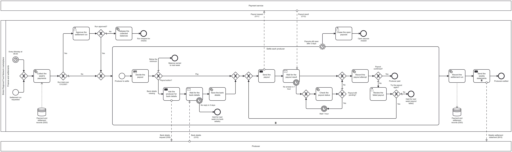

# P07 Settle producer payments (`settle_producer_payments`)

**Task:** 5.5 ([#167](https://github.com/ssrhaso/UFCFTR-30-3-DESP/issues/167)), the extra operational model
**Initial draft:** Royden Dias ([#168](https://github.com/ssrhaso/UFCFTR-30-3-DESP/pull/168)). **Refinements, DMN table, forms, layout and this document:** Hasaan Ahmad
**Status:** for review. The values of the draft rules DR1 to DR7 (section 9) are proposals until the group agrees them.



None of the three use cases covers P07. The model is the extra operational diagram that the tutor mentioned for extra credit. It follows FN2: FN2 records each payment with the producer amounts and the 5% commission in DS3 (R09), and P07 pays each producer once a week from those records (FR16, CS p. 2).

## 1. Files

| File | Content |
|---|---|
| `settle-producer-payments.bpmn` | The operational BPMN model and the executable Camunda 8.6 process. Process ID `settle_producer_payments` |
| `settle-producer-payments.png` | Export of the model, rendered with bpmn-js (the renderer of the Camunda Modeler) |
| `payout-decision.dmn` | DMN decision table `payout-decision` of the business rule task "Decide the payout" |
| `approve-settlement-run.form` | Camunda Form of the user task "Approve the settlement run" |
| `review-failed-payout.form` | Camunda Form of the user task "Review the failed payout" |
| `chase-open-payouts.form` | Camunda Form of the user task "Chase the open payouts" |
| `settle-producer-payments.md` | This document |

The strategic call activity P07 calls this process ([strategic.bpmn](../strategic/strategic.bpmn)), in the same way as P04 calls FN1 and P05 calls FN2.

## 2. Contributions

| Date | Member | Work |
|---|---|---|
| 15 Nov 2026 | Royden Dias | The initial draft of the model and its PNG export, with a table of seven possible refinements in [#168](https://github.com/ssrhaso/UFCFTR-30-3-DESP/pull/168) |
| 15 Nov 2026 | Hasaan Ahmad | Refinements 1 to 5 and 7 of that table, and four fixes from the review of the draft (R1 to R4 below). The DMN table, the three forms, the call activity P07 in the strategic model, the layout, this document, the P07 rows of the traceability table, NFR14 and the messages O05 to O12 in interactions.md |

| No. | Refinement | Result |
|---|---|---|
| 1 | Add the DMN table `payout-decision` | `payout-decision.dmn` (section 7) |
| 2 | Add the three Camunda Forms | `approve-settlement-run.form`, `review-failed-payout.form`, `chase-open-payouts.form` |
| 3 | Make P07 in the strategic model a call activity | `zeebe:calledElement` `settle_producer_payments` on P07. The none start event "Settlement run requested" is the entry point |
| 4 | Correlate the bank details reply on the run and the producer. Do not collect a balance that is still open | Correlation key `=settlementRunId + ":" + settlement.producerId`. The run marks each balance that it takes (R3) |
| 5 | Send a statement to every producer | Multi-instance send task "Send the weekly statements" after "Record the settlement run" |
| 6 | Agree the draft rules and Q2 | Open: the group agrees DR1 to DR7 (section 9) |
| 7 | Add this document, the traceability rows and the messages | This document. [traceability.md](../../requirements/traceability.md) section 3.1. [interactions.md](../../requirements/strategic/interactions.md) section 3.2 |
| R1 | A late payout must not be paid again | "No answer in 1 hour" now asks the service for the status. Only a confirmed failure goes to the review |
| R2 | A retry after a failure must be a new payout | The idempotency key has the attempt number `payoutAttempt` |
| R3 | Two runs must never pay the same balance | Collect marks each balance with the run. "Release the collected balances" and "Record the settlement run" remove the marks |
| R4 | Each payout attempt needs a record (NFR08) | Service task "Record the payout attempt" writes each attempt to DS3 at once |

## 3. How to read the model

| Part | Content |
|---|---|
| Payment service pool (top) | E01, sandbox or mock. It takes each payout request (O11) and returns the result (O12) |
| Network pool, lane F03 | `settle_producer_payments`, the executable process. Its only lane is F03 Finance and settlements, the owner of P07 |
| Before the sub-process | Two starts (the weekly timer and a manual start), "Collect the week's payments", and the approval of a large run |
| Sub-process "Settle each producer" | One instance for each producer, in parallel. The DMN table decides to pay, to hold or to carry over. The payout, the status check, the record of each attempt and the review of a failed payout |
| After the sub-process | "Record the settlement run", then "Send the weekly statements" to every producer (M10) |
| Producer pool (bottom) | A04. The bank details exchange (O09, O10) and the weekly statement (M10) |

**Who does each activity** (the brief asks the demonstration to show this):

| Actor | Activities |
|---|---|
| The finance manager (group `finance-manager`) | "Approve the settlement run" and "Chase the open payouts", in Camunda Tasklist |
| Finance (group `finance`) | "Review the failed payout", in Camunda Tasklist |
| The process engine | The gateways, the timers, the messages, the multi-instance loops and the DMN decision `payout-decision` |
| The job workers (6.1) | The 9 service and send tasks (section 8) |
| External participants | The payment service answers with a message (O12). The producer sends its bank details (O10) |

## 4. Elements for each point of the scope

The scope is the P07 row of [processes.md](../../requirements/strategic/processes.md) and FR16 of the [product backlog](../../requirements/product-backlog.md).

| Point of the scope | Element |
|---|---|
| The weekly settlement date (FR16, CS p. 2) | Timer start event "Every Monday at 06:00" |
| A run by hand, and the call from the strategic model | None start event "Settlement run requested" |
| The amount of each producer less the 5% commission (FR14, R09) | "Collect the week's payments" (`collect-settlement-data`) |
| The refunds of the week (R19) | "Collect the week's payments" subtracts them |
| A small or negative balance is not paid | "Decide the payout" (DMN, CARRY_OVER), end event "Balance carried to next week" |
| A producer without bank details | "Ask the producer for bank details" (O09), "Wait for the bank details" (O10), "Save the bank details" |
| The payment to the producer | "Send the payout" (O11), "Wait for the payout result" (O12) |
| A payout with no answer | "No answer in 1 hour", "Check the payout status", "Payout still pending?", "Wait 1 hour" |
| A failed payout | "Payout confirmed?" (No), "Review the failed payout", "Try the payout again?" |
| The audit trail for tax reporting (FR16, NFR08) | "Record the payout attempt", "Record the settlement run", data store DS3 |
| The statement to each producer (M10) | Multi-instance send task "Send the weekly statements" |
| The control of a large run (NFR01, E05) | "Run total over £10,000?", "Approve the settlement run", "Run approved?" |
| A run that stops | "Release the collected balances", end event "Run stopped for checks" |
| Payouts that stay open | Non-interrupting timer "Payouts still open after 2 days", "Chase the open payouts" |

## 5. Exception and alternative paths

Each path in the sub-process ends at a named end event. Each producer gets a statement, whatever the path.

| Situation | Path | Result |
|---|---|---|
| The run total is over £10,000 (DR2) | "Approve the settlement run" | Approve: the run continues. Stop: "Release the collected balances", then "Run stopped for checks" |
| The net amount is below £5.00 (DR3) | "Payout action?" (Below the minimum) | "Balance carried to next week". The next run adds the balance |
| No bank details on file | "Ask the producer for bank details", then "Wait for the bank details" | Reply: save the details and pay. No reply in 3 days (DR4): "Held for next week (no bank details)" |
| No answer to the payout in 1 hour (DR5) | "Check the payout status" | Confirmed: "Producer paid". Pending: wait 1 hour and check again. Failed: the review |
| The payout failed | "Review the failed payout" | Retry: a new attempt with a new idempotency key. Hold: "Held for next week (payout failed)" |
| Payouts are still open after 2 days (DR6) | "Chase the open payouts", in parallel with the open instances | The open instances keep waiting |
| A worker fails | 3 job retries, then an incident in Operate | No money moves twice: a job retry of "Send the payout" sends the same idempotency key |

## 6. Process variables

**Proposal:** the reply O10 carries only a reference to the details that the producer entered in the marketplace. Thus no process variable holds a bank account number (NFR01).

| Variable | Type | Set by | Read by |
|---|---|---|---|
| `settlementRunId` | String, for example `SR-2026-W46` | `collect-settlement-data` | All workers, the three forms, the correlation key of `bank-details-received` |
| `periodStart`, `periodEnd` | String, ISO 8601 date | `collect-settlement-data` | The forms, the statements |
| `runTotal` | Number (GBP) | `collect-settlement-data` | "Run total over £10,000?", form `approve-settlement-run` |
| `producerSettlements` | List of contexts: `producerId`, `producerName`, `grossAmount`, `commission`, `refunds`, `carriedIn`, `netAmount`, `bankDetailsOnFile` | `collect-settlement-data` | The input collection of "Settle each producer", forms `approve-settlement-run` and `chase-open-payouts` |
| `runDecision` | String: `APPROVE` or `STOP` | Form `approve-settlement-run` | "Run approved?" |
| `approvalNote` | String | Form `approve-settlement-run` (only to stop) | `release-settlement-balances` |
| `settlement` | Context: one entry of `producerSettlements`. Local to each instance | "Settle each producer" (input element) | The DMN table, the workers, form `review-failed-payout` |
| `payoutAction` | String: `PAY`, `HOLD` or `CARRY_OVER`. Local | DMN `payout-decision` | "Payout action?" |
| `payoutAttempt` | Number. Local (starts at 1) | The input mapping of the sub-process, the output mapping of "Review the failed payout" | `send-payout` (idempotency key), `record-payout-attempt`, form `review-failed-payout` |
| `payoutRequestId` | String. Local | `send-payout` | The correlation key of `payout-result`, `check-payout-status` |
| `payoutStatus` | String: `CONFIRMED`, `FAILED` or `PENDING`. Local | The message `payout-result`, `check-payout-status` | "Payout still pending?", "Payout confirmed?", `record-payout-attempt` |
| `payoutReference`, `failureReason` | String. Local | The message `payout-result`, `check-payout-status` | `record-payout-attempt`, form `review-failed-payout` |
| `retryDecision`, `reviewNote` | String (`RETRY` or `HOLD`), string. Local | Form `review-failed-payout`, through output mappings | "Try the payout again?", `settlementResults` |
| `settlementResults` | List of contexts: the producer, the amount, the payout variables and `outcome` (`PAID`, `CARRIED` or `HELD`) | "Settle each producer" (output collection) | `record-settlement-run`, the input collection of "Send the weekly statements" |
| `result` | Context: one entry of `settlementResults`. Local to each statement | "Send the weekly statements" (input element) | `send-settlement-statement` |
| `chaseNote` | String | Form `chase-open-payouts` | The audit trail |

The output element of "Settle each producer" calculates `outcome` with FEEL: `PAID` when `payoutStatus` is `CONFIRMED`, `HELD` when `payoutAction` is `PAY` or `HOLD`, and `CARRIED` in all other cases. The input mappings of the sub-process make the payout variables local, so the parallel instances do not overwrite each other.

**Example of the output of `collect-settlement-data`.** The run total is over £10,000, so it shows the approval. The three producers take the three paths: PR-01 is paid, PR-02 waits for bank details, and PR-03 is carried over.

```json
{
  "settlementRunId": "SR-2026-W46",
  "periodStart": "2026-11-09",
  "periodEnd": "2026-11-15",
  "runTotal": 10738.90,
  "producerSettlements": [
    { "producerId": "PR-01", "producerName": "Avon Valley Dairy", "grossAmount": 6420.00, "commission": 321.00, "refunds": 0, "carriedIn": 0, "netAmount": 6099.00, "bankDetailsOnFile": true },
    { "producerId": "PR-02", "producerName": "Mendip Bakery", "grossAmount": 4890.40, "commission": 244.52, "refunds": 12.50, "carriedIn": 3.10, "netAmount": 4636.48, "bankDetailsOnFile": false },
    { "producerId": "PR-03", "producerName": "Chew Valley Preserves", "grossAmount": 3.60, "commission": 0.18, "refunds": 0, "carriedIn": 0, "netAmount": 3.42, "bankDetailsOnFile": true }
  ]
}
```

## 7. Decision, messages and timers

**DMN decision `payout-decision`** (hit policy UNIQUE: exactly one rule applies to each producer).

| Net amount (£) | Bank details on file | Payout action | Rule |
|---|---|---|---|
| `< 5` | `-` | `"CARRY_OVER"` | Below the minimum (DR3), or zero or less after refunds |
| `>= 5` | `not(true)` | `"HOLD"` | No bank details (false or missing) |
| `>= 5` | `true` | `"PAY"` | Pay this week |

A missing amount matches no rule. The default flow of "Payout action?" then carries the balance over, so nothing is paid by mistake.

| Kind | Name | Detail |
|---|---|---|
| Message | `payout-result` | Correlation key `=payoutRequestId`. The payload gives `payoutStatus`, `payoutReference` and `failureReason` |
| Message | `bank-details-received` | Correlation key `=settlementRunId + ":" + settlement.producerId`. The request (O09) carries this reference |
| Timer | "Every Monday at 06:00" | Cron `0 0 6 * * MON` (DR1) |
| Timer | "No reply in 3 days" | `P3D` (DR4) |
| Timer | "No answer in 1 hour", "Wait 1 hour" | `PT1H` (DR5) |
| Timer | "Payouts still open after 2 days" | `P2D`, non-interrupting (DR6) |

## 8. Job types for the workers (6.1)

Each service and send task has 3 job retries. No worker throws a BPMN error: a failure after the retries raises an incident.

| Job type | Task | Rule |
|---|---|---|
| `collect-settlement-data` | Collect the week's payments | Read the payments of the week from DS3, subtract the refunds (R19) and add the balances that earlier runs carried or held. Mark each balance with `settlementRunId`, and skip each balance with the mark of an open run (NFR14). Return the variables of section 6 |
| `release-settlement-balances` | Release the collected balances | Remove the mark of this run from each balance |
| `request-bank-details` | Ask the producer for bank details | Send O09 with the reference `settlementRunId:producerId` |
| `save-bank-details` | Save the bank details | Store the account details for this run and later runs |
| `send-payout` | Send the payout | Send `settlement.netAmount` to the sandbox or mock (NFR02). The idempotency key is `settlementRunId`, `producerId` and `payoutAttempt`. Return `payoutRequestId` |
| `check-payout-status` | Check the payout status | Ask the service for the status of `payoutRequestId`. Return `payoutStatus` (`CONFIRMED`, `FAILED` or `PENDING`) with `payoutReference` or `failureReason`. An unknown request is `FAILED` |
| `record-payout-attempt` | Record the payout attempt | Write the attempt and its result to DS3 with the time (NFR08) |
| `record-settlement-run` | Record the settlement run | Write the summary of the run from `settlementResults`. Remove the mark of this run from each carried or held balance |
| `send-settlement-statement` | Send the weekly statements | One statement for each `result`: the orders, the commission, the refunds, the amount paid, carried or held, and the payout reference (M10) |

The sandbox webhook or the mock publishes `payout-result`. The marketplace publishes `bank-details-received` when the producer replies.

## 9. Draft rules DR1 to DR7

These values are proposals of the initial draft, like S1 to S4 were for FN2. The group agrees them, then records them here.

| No. | Proposal in the model | Where to change it |
|---|---|---|
| DR1 | The run starts every Monday at 06:00 and settles the payments of the previous Monday to Sunday | Start event "Every Monday at 06:00" |
| DR2 | The finance manager approves a run over £10,000 before any money leaves the network | Gateway "Run total over £10,000?" |
| DR3 | The minimum payout is £5.00. A smaller balance is carried to next week | `payout-decision.dmn` |
| DR4 | A producer has 3 days to send missing bank details | Timer "No reply in 3 days" |
| DR5 | The process waits 1 hour for the payout result, then asks for the status every hour | Timers "No answer in 1 hour" and "Wait 1 hour" |
| DR6 | A run should finish within 2 days. After that, the finance manager chases the open payouts | Timer "Payouts still open after 2 days" |
| DR7 | The payment service E01 also pays the producers. This answers Q2 of [actors.md](../../requirements/strategic/actors.md) for now | Collapsed pool "Payment service", messages O11 and O12 |

## 10. Design decisions

| Decision | Choice | Reason |
|---|---|---|
| Payout decision | A DMN decision table | The group can change the minimum without a change to the BPMN. Refinement 1 |
| One instance for each producer | A parallel multi-instance sub-process with local variables | A problem with one producer does not stop the others |
| No answer in time | Ask the service for the status. Do not treat the timeout as a failure | The service can pay after the hour. A second payout would pay the producer twice (NFR14). R1 |
| Retry after a failure | A new attempt number in the idempotency key | Most payment services, Stripe included, return the first result again for a repeated key. A job retry keeps the same key, so it cannot pay twice. R2 |
| Overlapping runs | Collect marks each balance with the run | A run can stay open for more than a week (the review has no time limit). The mark also keeps a manual run away from the open balances. Zeebe correlates a message to only one open subscription of the same process ID, so this also protects the bank details reply. R3 |
| Audit trail | Record each attempt at once, and the run at the end | A failed attempt has a record, also if the run stops later (NFR08). R4 |
| Statements | One multi-instance send task after the record of the run | Every producer gets a statement, also for a carried or held balance. The statement matches the recorded trail. Refinement 5 |
| Producer | A collapsed pool, not a lane | As in FN2: the producer acts outside the engine. The strategic model uses a lane (D9) |
| Two joins before "Send the payout" | `Gateway_JoinPay` and `Gateway_JoinRetry` stay separate | One join with three inputs would put the retry loop on top of the bank details path |
| Strategic link | The call activity P07 starts the none start event | A call activity cannot start a timer start event. Refinement 3 |

## 11. Traceability

The strategic model shows only the happy path (D1). Thus the hold, retry and approval paths have no strategic element. P07 has no story yet: FR16 is Task 2 in the [product backlog](../../requirements/product-backlog.md).

| Element | i* element ([model-content.md](../istar/model-content.md)) | Strategic BPMN | Requirements |
|---|---|---|---|
| Every Monday at 06:00, Settlement run requested | NW06 Settle producers weekly | Start_P07 "Weekly settlement date", call activity P07 | FR16 |
| Collect the week's payments | NW06, SD20 Payment and settlement records | P07 in F03, R09 and R19 through DS3 | FR14, FR16, NFR05, NFR14 |
| Decide the payout, Send the payout, Wait for the payout result | NW06, PR09 Weekly settlement received, SD17 | P07 | FR16, NFR02 |
| Ask the producer for bank details, Wait for the bank details, Save the bank details | PR09, SD17 | None (happy path) | FR16, NFR01 |
| Check the payout status, Review the failed payout, Release the collected balances | NW06 helps NW14 Trust | None (happy path) | NFR04, NFR14 |
| Record the payout attempt, Record the settlement run | NW19 Keep financial audit trail, MP32 Auditability, SD18 Transparent audit trail | P07 | FR16, NFR08 |
| Send the weekly statements | SD17 Weekly settlement with statement, PR14 Tax-ready accounts, SD32 Producer tax report | M10 to the Producer lane, End_P07 | FR16, NFR08, NFR10 |
| Run total over £10,000?, Approve the settlement run | NW09 Regulations complied with | None (happy path) | NFR01 (E05) |
| Payouts still open after 2 days, Chase the open payouts | NW06 | None (happy path) | FR16 |

The documentation field of each element gives the same IDs (NFR09). Section 3.1 of [traceability.md](../../requirements/traceability.md) gives the same links for each requirement.

## 12. Checks

| Check | Result |
|---|---|
| `bpmnlint:recommended` and `camunda-compat/camunda-cloud-8-6`, with the Zeebe schema loaded, as in the Web Modeler | 0 errors, 0 warnings. A copy with a task definition removed gives the expected errors, so the rules run |
| The CI command `npx bpmnlint@11.14.0` with `.bpmnlintrc` | 0 problems |
| Import with bpmn-js 17.11 | No import warnings. The PNG export comes from this import |
| The DMN rules, with feelin 8.2 | 8 input cases, including a negative amount and missing bank details: exactly one rule for each. A missing amount matches no rule, as section 7 says |
| The FEEL expressions of the model (`outcome`, `payoutAttempt`, the correlation key) | Tested with feelin 8.2 |
| The three forms with form-js 1.10.1 (schema version 16, Camunda 8.6) | All three render the example of section 6 with no errors. The required fields are checked, and the stop reason shows only for a stopped run |
| The strategic model after the change of P07 | 0 errors, 0 warnings with the same two rule sets |
| Deployment to the Camunda 8 cluster | To do in 6.1 |

## 13. How to run it in Camunda

1. After the merge into `main`, merge `main` into `camunda-sync`. Then sync the Camunda project.
2. Open `settle-producer-payments.bpmn` in the Web Modeler. Make sure that the problems panel shows no errors.
3. Deploy the diagram with `payout-decision.dmn` and the three forms.
4. Start an instance at "Settlement run requested".
5. The 6.1 worker `collect-settlement-data` returns the variables of section 6. Until the workers exist, complete each job through the Zeebe REST API with the example variables.
6. Approve the run in Tasklist as a member of `finance-manager`.
7. Follow the instance in Operate. PR-01 is paid, PR-02 waits for its bank details, and PR-03 is carried over.
