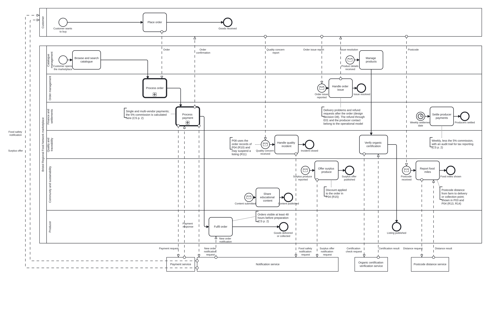

# Figure 1: strategic BPMN model

**Authors:** Shamy, Ishaq Modassir Mushtaq, Royden Dias
**Task:** Figure 1, the strategic BPMN model of the enterprise (Sprint 1 criterion "Strategic BPMN Model")
**Status:** refreshed on 6 Nov 2026 after a check against the BPMN 2.0 specification and Real-Life BPMN, chapter 3

## 1. What the figure shows

The figure is the network pool with a lane for each of its parties (the five functions and the producers), the customer as a separate pool above it, and collapsed pools for the four external services, as Real-Life BPMN draws a strategic model with an external customer (Freund and Rücker, 2019, sections 3.2 and 3.3.1). It shows what the brief asks for: the major business processes, the organisational functions that own them, the key actors, the external organisations and services, the interactions between them and the relationships between the processes (UWE Bristol, 2026c, p. 3).

| Element of the brief | In the figure | Defined in |
|---|---|---|
| Major business processes | The twelve processes P01 to P12, one activity each | [processes.md](../../requirements/strategic/processes.md), section 3 |
| Organisational functions and responsibilities | The five function lanes F01 to F05 of the network pool, above the Producer lane | processes.md, sections 2 and 4 |
| Key actors | The Customer pool (A01 to A03), the Producer lane (A04) and the network itself (A05, the pool, with the roles A06 and A07 inside F04) | [actors.md](../../requirements/strategic/actors.md), section 2 |
| External organisations and services | The four collapsed pools E01 to E04 | actors.md, section 3 |
| Interactions | The eight customer messages and the ten service messages as message flows; the producer messages of the register are hand-overs between the lanes (D9) | [interactions.md](../../requirements/strategic/interactions.md), section 3.1 |
| Relationships between the processes | The sequence flows inside the pool (R01, R05, R06), the notification to the producer (R08) and seven text annotations; the data relationships R02 to R04, R07 and R09 to R17 are in the register only | interactions.md, section 4 |

## 2. How to read it

- The order chain reads the way the book draws it: in the Customer pool the customer wants to buy, places the order and receives the goods; in the network the catalogue serves the browsing, Order management and Finance process the order and the Producer lane fulfils it. The listing chain ends with the producer.
- A rounded box is a process. The two boxes with a plus sign, Process order (P04) and Process payment (P05), are call activities: they stand for the operational models FN1 and FN2 of [functionalities.md](../../requirements/scope/functionalities.md).
- A thin circle starts a process. An envelope in it means a message starts it, a clock means a schedule (the weekly settlement). The plain start of P03 is the customer's own visit to the marketplace.
- A thick circle ends a process. Its name is the outcome.
- There are no decisions in the figure: it is the happy path (decision D1, tutor feedback of 9 Nov 2026). The stock check, the organic claim, the certification result and the payment result are decided in the operational models.
- A dashed arrow is a message between pools: the customer and the network, or the network and a service. A solid arrow that crosses a lane is a hand-over inside the network: Finance to the Producer, Quality to the Producer. Solid arrows never cross a pool.
- A dotted line joins a note to the process it explains. The notes give the business rules of the case study (48 hours, weekly settlement, 5% commission, postcode distance) and the links between processes that the arrows cannot show.

## 3. Processes, functions and i* elements

| Process | Lane (function) | Trigger | Outcome | i* elements |
|---|---|---|---|---|
| P01 Manage products | F01 Catalogue management | Product details received from the Producer lane (M01) | Listing published, in the Producer lane, after P02 where organic certification is claimed | PR04, SD11 |
| P02 Verify organic certification | F04 Quality and traceability | An organic claim in P01 | Verified or rejected (M02, M03) | SD25 |
| P03 Browse and search catalogue | F01 Catalogue management | The customer opens the marketplace | The customer places the order from the Customer pool (M04); the stock check is in the operational model | CU02, CU04, SD02 |
| P04 Process order | F02 Order management | The customer orders (M04) | The marketplace order, split by producer | SD01, MP03, MP05, SD12, SD13 |
| P05 Process payment | F03 Finance and settlements | The order from P04 | Order confirmed (M07) with the stock updated and the producers notified (M08, M09); the declined and retry paths are in the operational model | MP04, MP15 to MP19, SD19 |
| P06 Fulfil order | Producer | The paid order from P05, notified through E03 (M08, M09) | Goods delivered or collected (the customer receives them in the Customer pool) | PR07, SD10, CU12 |
| P07 Settle producer payments | F03 Finance and settlements | The weekly settlement date | Producers settled (M10) | NW06, PR09, SD17, SD32 |
| P08 Handle quality incident | F04 Quality and traceability | A quality concern (M11, M12) | Incident closed (M13, M14, M15) | NW07 |
| P09 Report food miles | F05 Community and sustainability | A customer postcode (M16) | Food miles shown (M17, M18) | SD26, SD40 |
| P10 Offer surplus produce | F05 Community and sustainability | A surplus produce report (M19) | Surplus offer published (M20, M21) | SD38 |
| P11 Share educational content | F05 Community and sustainability | Content submitted (M22) | Content published | SD39 |
| P12 Handle order issue | F02 Order management | A delivery problem or a refund request after the order (M24) | Issue resolved (M25) | CU18, SD41, NW15, MP33 |

The i* elements are in [model-content.md](../istar/model-content.md); its section 7.1 maps them to the figure. Each element of the model repeats its IDs in its documentation field, after "i*:".

## 4. Design decisions

The full decisions D1 to D7 and their reasons are in interactions.md, section 8. In short:

1. One message for each business document that passes between organisations; screen steps and request-response pairs between a person and the network stay in the operational models. The figure is the happy path with no gateways; every decision is in the operational models (D1, tutor feedback of 9 Nov 2026).
2. The notification service is a separate pool, so the delivery channel is visible (D3).
3. The network pool has a lane for each of its parties, including the producers; the customer is a separate pool because customers are not members of the network; the producer messages are lane hand-overs (D9, tutor feedback of 9 Nov 2026).
3. Producers are settled when the payment succeeds, not when the goods are delivered; the tutor is asked to confirm (D4).
4. The data stores DS1 to DS4 are not drawn. Data objects were tried on 6 Nov 2026 and removed again: the brief does not ask for them and they overloaded the figure (D7).
5. The lanes are named as organisational functions (Catalogue management, Order management, Finance and settlements, Quality and traceability, Community and sustainability); the IDs F01 to F05 are unchanged (processes.md, section 2).
6. P12 Handle order issue is a group design decision: the sources cover cancellation before payment and food safety only, but a marketplace that takes payment for delivered goods needs a post-sale path, and consumer law gives a refund right in distance sales (D8).
7. The BRF Network process is marked executable, its conditions are FEEL expressions and the amend-order event carries a job type only because Camunda Web Modeler requires one executable process per diagram. The strategic model is not deployed.

## 5. Checks

- bpmnlint with the `bpmnlint:recommended` rules (the repository's `.bpmnlintrc`, run by the BPMN lint workflow after each merge into main).
- The connection rules of the specification: sequence flows stay inside a pool, message flows cross pools, every flow node has a start and an end (Object Management Group, 2011, sections 7.5 and 10.4).
- The strategic conventions of Real-Life BPMN, chapter 3: happy path with no decisions, no task typing, typed start events, outcomes as end events, one pool with a lane for each internal party, a separate pool for the external customer and collapsed pools for the services, start and end with the customer, at most eight artifacts (Freund and Rücker, 2019, section 3.3).

## 6. Open questions

| No. | Question | Where |
|---|---|---|
| T3 | Is P02 (organic certification verification through E02) required? | processes.md, section 6 |
| Q2 | Who pays the weekly settlements to the producers? | actors.md, section 5 |
| Q3 | Are the notification service (E03) and the postcode distance service (E04) internal or external? | actors.md, section 5 |
| D4 | Does settlement wait for fulfilment? | interactions.md, section 8 |
| G2 | Is the post-sale process P12 accepted? | processes.md, section 6 |

## 7. Editing the model

The model is edited in Camunda Web Modeler and downloaded here, with a PNG export of the same version (definition of done in the root [README](../../README.md)). `strategic.bpmn` is the source; `strategic.png` is the export. After a change, run the lint, re-export the PNG and commit both.

## 8. References

Freund, J. and Rücker, B. (2019) *Real-life BPMN: using BPMN and DMN to analyze, improve, and automate processes in your company*. 4th edn. Berlin: Camunda.

Object Management Group (2011) *Business Process Model and Notation (BPMN), version 2.0*. formal/2011-01-03. Needham, MA: OMG. Available at: https://www.omg.org/spec/BPMN/2.0 (Accessed: 6 November 2026).

UWE Bristol (2026a) *Bristol Regional Food Network: digital marketplace* [Case study]. UFCFTR-30-3 Distributed and Enterprise Software Development. Unpublished.

UWE Bristol (2026c) *Assessment Task 1 brief* [Assessment brief]. UFCFTR-30-3 Distributed and Enterprise Software Development. Unpublished.
